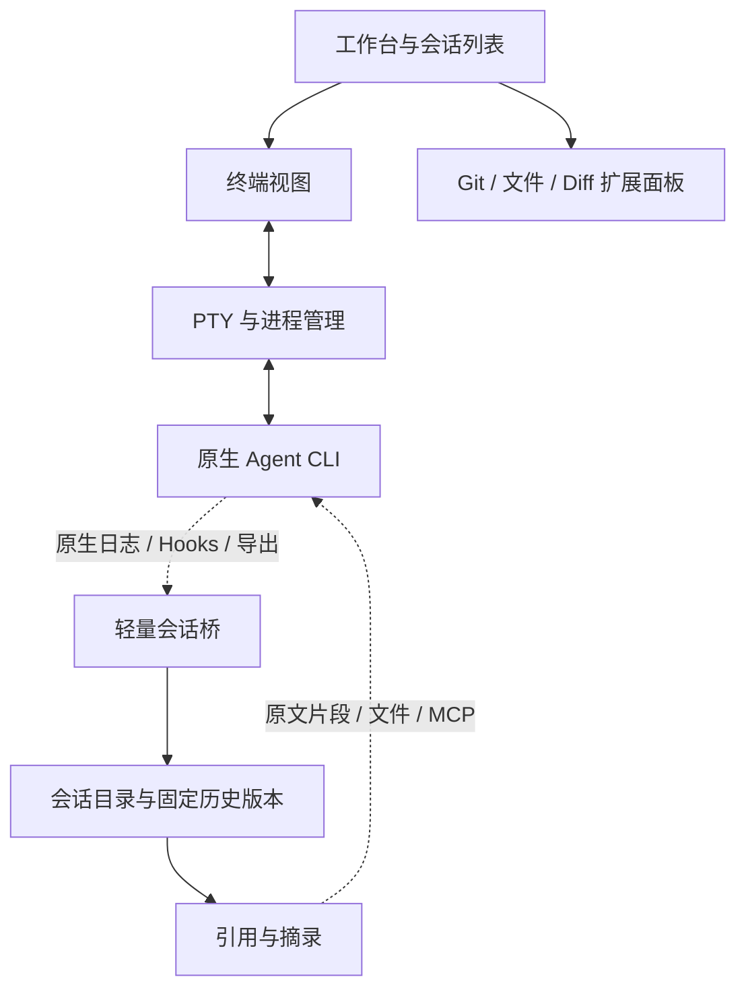

# 终端优先工作台设计提案

状态：历史备选，当前主线已调整为[现有 Aibo 的彻底重构](adr/0002-aibo-refactor-direction.md)。下文保留终端路线当时的设计，不作为当前功能范围或实施要求。原决定见 [ADR 0001](adr/0001-terminal-transcript-references.md)。

## 产品范围

核心体验是让用户直接使用各 Agent 的原生 CLI，并把一个会话的原始 transcript 引用到另一个会话。工作台保留持久会话列表，为 Git、文件浏览和 Diff 等面板保留扩展空间。

原生 CLI 负责自身的对话、工具输出、审批、模型与命令交互。Aibo Rev 负责会话目录、终端承载、原文引用和工作区面板。统一聊天渲染、完整通用插件平台及完整 Agent 管理中心不自动成为本路线的前置承诺；是否需要这些能力要另行决定。

另有[原生 CLI 执行与 GUI 历史阅读方案](cli-gui-reading-proposal.md)：保留上述执行分工，并为同一会话提供只读的图形化历史、搜索和引用入口。该方案已记录供比较，尚未选定，不要求把审批和输入改为统一 GUI。

## 候选架构

会话桥的候选职责是启动与可用时恢复原生会话、识别原生会话身份、发现或导入 transcript、捕获版本及定位摘录。它无需接管整个 Agent 执行协议。

会话目录项与终端实例分开：持久历史不因视图关闭而丢失。关闭视图、停止进程、归档及删除历史的具体交互与保留规则尚待确定，不能把“终端标签列表”直接当成持久会话管理。

面板扩展优先围绕工作区、选中文件、打开面板和终端等少量共享信息设计；Git 面板不应为了展示 diff 而接入聊天消息协议。具体公开扩展合同尚未冻结。

## 引用流程

1. 用户从会话列表选择来源，并点击引用。
2. 会话桥捕获一个固定 transcript 版本，记录来源与实际捕获范围。
3. 按设置生成原文摘录，保留关联工具记录并受总大小预算约束。摘录说明与原文分开，缺省轮数和预算仍待选择。
4. 把来源信息、引用版本、摘录及完整读取说明插入目标 CLI 输入框；不兼容时提供复制入口。
5. 用户检查并发送；目标 Agent 可通过已配置的 MCP 工具等方式读取该固定版本的全文。

发送后不从来源实时文件补读“最新内容”。完整原文与用于查找的索引分开保存；原文不因索引、展示或摘录而被重写。

## 终端与协议选择

- 原生 CLI + PTY 是当前建议验证的主路线。ACP 是结构化 Agent 接入协议，使用它通常仍需由客户端实现消息和交互展示，不是原生 CLI 界面的嵌入协议。
- Ghostty 是终端引擎候选，尚未选定。需区分终端状态解析库、完整渲染能力与桌面视图集成，并验证所用版本及目标平台。
- 原项目已有 `xterm.js + portable-pty` 终端插件，可作为验证基础。其滚动输出仅内存保存，尚不提供本方案的持久会话及 transcript 引用闭环。
- 不预先维护 PTY 与 ACP 两套完整交互路径；若后续确有 Agent 需要协议接入，再评估成本。

## 首个验证闭环

选择两个不同 Agent，在原生 CLI 交互下完成：捕获来源 transcript → 点击引用冻结 → 插入带工具记录的摘录 → 接收 Agent 通过 MCP 读取同一版本全文。

验证来源继续写入后原文不会变化、分页可完整重组、接收 Agent 能理解来源格式、粘贴不意外执行输入，以及无历史入口时手动导入的可用性。终端滚动文本不能代替 transcript 完整性证据。

## 待解决问题

- 首批 Agent、目标操作系统、终端引擎及桌面框架。
- transcript 正在写入、末尾记录不完整或旧记录被改写时的捕获一致性。
- 默认轮数和大小预算、单条工具输出超限时的摘录规则。
- 引用存储、保留与删除策略，来源删除后引用的行为。
- MCP 配置、调用者身份、引用读取范围，以及缺少工具支持时的文件交付。
- 进程与视图的生命周期、运行状态的可靠来源、故障恢复保证。
- 工作区面板的扩展合同，以及旧 Aibo 历史迁入本路线的范围。
