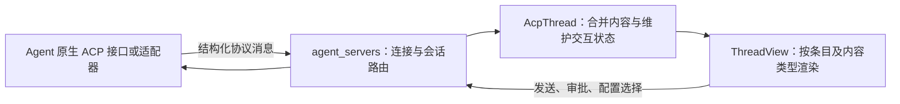

# Zed、ACP 与统一会话呈现研究

日期：2026-11-01。性质：研究记录，不替代完整版本 Checklist，也不构成已接受的实现决定。下文区分协议规定、Zed 官方产品说明和对 Aibo 重构的推论。协议资料以官网当前的 **v1 Latest** 为主；**v2 Draft** 单独说明，不能混作当前实现合同。

## ACP 提供的是会话语义

ACP v1 的 `session/new` 创建会话并返回 `sessionId`；客户端用 `session/prompt` 发送内容。Agent 通过 `session/update` 通知发送消息片段、工具活动和会话状态变化。这些通知可以发生在执行期间，也可以发生在历史加载期间。[Session Setup](https://agentclientprotocol.com/protocol/v1/session-setup)、[Prompt Turn](https://agentclientprotocol.com/protocol/v1/prompt-turn)

| 协议内容 | 客户端可据此构建的界面 |
| --- | --- |
| `agent_message_chunk` / `user_message_chunk` | 用户与 Agent 消息内容，累积流式片段 |
| `agent_thought_chunk` | Agent 主动提供的思考内容；不能据此要求 Agent 暴露未提供的内部过程 |
| `tool_call` / `tool_call_update` | 用 `toolCallId` 关联同一操作的创建、执行状态和结果 |
| 工具的 `kind`、`title`、`locations` | 通用工具分类、说明及文件跳转入口 |
| 工具内容中的普通内容、`diff`、`terminal` | 内容块、修改对比、终端输出区域 |
| `plan` | 计划与步骤状态 |
| `available_commands_update` | 动态命令补全列表 |
| `config_option_update` / `session_info_update` | 当前配置、会话标题等元数据更新 |

以上是标准语义可以支持的呈现方式，并非对 Zed 当前每一种组件的实现断言。它让客户端按内容类型构建 GUI，无需识别 CLI 的 ANSI 颜色、光标位置或终端布局。[Prompt Turn](https://agentclientprotocol.com/protocol/v1/prompt-turn)、[Tool Calls](https://agentclientprotocol.com/protocol/v1/tool-calls)

工具显示统一不等于工具实现统一。`kind` 是粗粒度分类，具体工具名只是信息；执行仍由 Agent 组织。`rawInput` / `rawOutput` 可携带任意 JSON，协议没有为所有工具建立完整领域模型。因此通用卡片可以复用，但专门展示某类业务结果仍可能需要额外适配。[Tool Calls](https://agentclientprotocol.com/protocol/v1/tool-calls)

## 交互与配置也能部分统一

审批通过 `session/request_permission` 发出，Agent 给出可选项，客户端返回所选 `optionId` 或取消。允许一次、总是允许等 `kind` 帮助客户端呈现；长期记住选择的范围和期限由 Agent 决定，不能由统一按钮外观推断所有 Agent 的授权语义相同。[Tool Calls](https://agentclientprotocol.com/protocol/v1/tool-calls)

会话级配置可以由 Agent 返回 `configOptions`：标识、名称、分类、当前值和可选值。客户端用通用选择器展示模型、模式、推理级别等；`session/set_config_option` 的响应返回完整当前配置列表。当前 v1 默认支持 `select`，`boolean` 需要客户端声明相应能力；未知控件类型可忽略，Agent 继续使用当前值。官方推荐 `configOptions` 优先于旧 `modes` 字段。这是会话配置合同，并非 Agent 全部原生配置文件的通用编辑协议。[Session Config Options](https://agentclientprotocol.com/protocol/v1/session-config-options)

Slash command 的名称、说明和输入提示可动态公布，调用方式仍是将命令文本放入普通 prompt；这能复用命令菜单，但不保证原生 CLI 的每一个命令都对 ACP 开放。[Slash Commands](https://agentclientprotocol.com/protocol/v1/slash-commands)

当前规范还定义 `elicitation/create`，在双方支持相应能力时提供表单或 URL 交互。这是规范可表达的能力，是否可用仍要核对具体客户端和 Agent 的版本与实现。[Elicitation](https://agentclientprotocol.com/protocol/v1/elicitation)

ACP v1 的终端方法允许 Agent 请求客户端启动命令、读取输出和管理进程，并可将终端关联到工具调用。它与把整套 Agent CLI/TUI 放进终端是不同的接入方式；不能把 `terminal` 内容块理解为自动转换任意 TUI。[Terminals](https://agentclientprotocol.com/protocol/v1/terminals)

## 会话历史与原始 transcript 的边界

`session/list` 提供 Agent 所知道的会话目录，须先检查 `sessionCapabilities.list`。`session/load` 须检查 `loadSession`；支持时 Agent 通过 `session/update` 重放会话历史，再恢复交互。目录发现和历史重放是可选能力，不因 Agent 支持基础聊天就自动成立。[Session List](https://agentclientprotocol.com/protocol/v1/session-list)、[Session Setup](https://agentclientprotocol.com/protocol/v1/session-setup)

Zed 官方文档说明，已配置的 External Agent 可以通过 ACP 导入会话目录；导入项进入归档历史，打开后恢复。没有工作目录的会话会被跳过，已有会话不会重复导入。这个说明只证明其产品有导入与恢复流程，不能据此认定 Zed 独立保存了每个外部 Agent 的完整原始历史。[Zed External Agents — Importing Threads](https://zed.dev/docs/ai/external-agents#importing-threads)

**对 Aibo 的推论：** ACP 历史重放是面向客户端的结构化会话表示；它不等于原生 transcript 文件的逐字节导出，也没有把 Agent A 的内部运行状态变成 Agent B 可直接恢复的状态。若保留“原始 transcript 引用”的产品要求，需要另外定义原始记录的获取、保存、来源定位与读取范围，不能仅把 ACP 事件改名为原始 transcript。若改为引用 ACP 所表达的可读历史，应明确该范围并保留不能表达的信息边界。[Session Setup](https://agentclientprotocol.com/protocol/v1/session-setup)

## Zed 官方说明展示的取舍

Zed 将 External Agent 的 thread 放在 Agent Panel / Threads Sidebar，Agent 通常仍拥有自己的运行时、认证、模型选择、工具和原生配置。Zed 配置的 MCP 可以转发，原生 Agent 也可能读取自己的 MCP 配置；Zed Agent profiles 和 Zed Skills 不自动成为外部 Agent 的配置。[Zed External Agents — Configuration Boundaries](https://zed.dev/docs/ai/external-agents#configuration-boundaries)

因此，统一工作台可以提供一致的会话操作入口，同时保留原生认证与配置的边界。**不能从 Zed 能显示统一 thread 推导出它已经复刻每个 Agent CLI 的全部能力。** 在需要直接运行 CLI/TUI 时，官方文档另有 Terminal Threads 路径。[Zed External Agents](https://zed.dev/docs/ai/external-agents)

## 仍会保留的适配成本

初始化会协商协议版本、双方能力和认证方式。图片、历史加载、终端等能力应按声明启用，不能按品牌猜测，也不能把一种 Agent 的能力当作所有 Agent 的基础能力。[Initialization](https://agentclientprotocol.com/protocol/v1/initialization)

ACP 允许 `_meta`、自定义方法及自定义能力。由此可以接入协议之外的功能，但双方仍需约定含义；这些扩展不会因为放进 ACP 信封就自动获得跨 Agent 互通或通用 GUI。[Extensibility](https://agentclientprotocol.com/protocol/v1/extensibility)

**研究判断：** ACP 能明显减少“各 Agent 的通用聊天、工具进度、审批和会话配置分别实现一套 GUI”的重复工作；适配器仍需准确描述原生行为。专有工作流、完整原生配置、原始历史、子 Agent 关系等超出已协商标准能力的部分，仍要专门接入、保留原生入口或明确不支持。这个收益是架构层面的判断，尚无本项目维护工时或性能测量支撑。

## 协议演进需要隔离

官网当前把 v2 标为 Draft，并建议 v1/v2 并行协商、v2 在稳定前使用功能开关。v2 草案已经改变了 prompt 生命周期和流式更新模型：响应只表示接受，完成通过状态更新表达；消息与工具调用按 ID 更新；客户端文件系统、终端执行与旧 session modes API 被移除。不能仅依据草案推断当前 Zed 或 Aibo 已具备这些能力；下节另行核查 Zed 的版本选择路径。[Migrating from v1](https://agentclientprotocol.com/protocol/v2/migration)

**对 Aibo 的推论：** 协议版本转换应集中在接入边界，GUI 和长期历史格式保持明确、自有且尽量小的语义模型。否则每次协议演进都可能同时牵动持久化、恢复、历史引用和界面，抵消采用标准协议的维护收益。

## 源码核查：消息怎样变成 thread

本节固定在 Zed 提交 [`ba63a022c9a2`](https://github.com/zed-industries/zed/commit/ba63a022c9a22ca66d68ef2a8f0bb9b5b0a9984d)（2026-10-31），为静态源码核查，未运行 Zed。后续版本可能调整模块路径和协议支持范围。

1. **连接层启动 Agent 并协商能力。** 外部 Agent 通过 stdio 子进程连接；消息由 ACP SDK 解码并送入前台队列。v1 的 `handle_session_notification` 根据 `sessionId` 找到会话，再调用 `thread.handle_session_update`。这条路径处理协议对象，不读取终端屏幕布局。[进程连接](https://github.com/zed-industries/zed/blob/ba63a022c9a22ca66d68ef2a8f0bb9b5b0a9984d/crates/agent_servers/src/acp/transport.rs#L31)、[通知路由](https://github.com/zed-industries/zed/blob/ba63a022c9a22ca66d68ef2a8f0bb9b5b0a9984d/crates/agent_servers/src/acp/v1.rs#L10208)
2. **Thread 是客户端维护的会话对象。** `AcpThread` 保存条目列表、会话信息、计划、待审批请求、提问、终端、使用量及运行状态。`AgentThreadEntry` 包含用户消息、助手消息、会话消息、工具调用、提问和上下文压缩；它不是直接显示每一个 JSON 通知。[条目类型](https://github.com/zed-industries/zed/blob/ba63a022c9a22ca66d68ef2a8f0bb9b5b0a9984d/crates/acp_thread/src/acp_thread.rs#L565)、[Thread 状态](https://github.com/zed-industries/zed/blob/ba63a022c9a22ca66d68ef2a8f0bb9b5b0a9984d/crates/acp_thread/src/acp_thread.rs#L3630)
3. **流式片段更新已有内容。** v1 正文与思考事件进入同一内容合并路径，但保留不同的 chunk 类型。相容的连续片段合并；工具更新按调用 ID 找到条目并修改状态、内容与位置。显示速度的缓冲采用指向已保留源内容的游标，避免另建一份权威正文。[事件分派](https://github.com/zed-industries/zed/blob/ba63a022c9a22ca66d68ef2a8f0bb9b5b0a9984d/crates/acp_thread/src/acp_thread.rs#L4873)、[内容合并](https://github.com/zed-industries/zed/blob/ba63a022c9a22ca66d68ef2a8f0bb9b5b0a9984d/crates/acp_thread/src/acp_thread.rs#L5601)、[工具更新](https://github.com/zed-industries/zed/blob/ba63a022c9a22ca66d68ef2a8f0bb9b5b0a9984d/crates/acp_thread/src/acp_thread.rs#L6114)
4. **GUI 观察状态并按类型渲染。** `ThreadView` 订阅 thread；列表按条目索引调用 `render_entry`。正文与思考有不同的展示分支，工具内容进一步分派到普通内容、diff editor、终端、patch 或兜底 Markdown。工具名不必逐一匹配才有基本显示，但未知类型也不保证都能获得丰富组件。[订阅](https://github.com/zed-industries/zed/blob/ba63a022c9a22ca66d68ef2a8f0bb9b5b0a9984d/crates/agent_ui/src/conversation_view/thread_view.rs#L1036)、[列表与消息呈现](https://github.com/zed-industries/zed/blob/ba63a022c9a22ca66d68ef2a8f0bb9b5b0a9984d/crates/agent_ui/src/conversation_view/thread_view.rs#L7271)、[工具内容呈现](https://github.com/zed-industries/zed/blob/ba63a022c9a22ca66d68ef2a8f0bb9b5b0a9984d/crates/agent_ui/src/conversation_view/thread_view.rs#L11611)
5. **交互沿同一连接返回。** v1 权限请求先关联到 thread 和工具调用，将 Agent 给出的选项转为宿主审批状态；用户选择后再完成对应 RPC。界面并非只能被动读取 transcript。[v1 权限请求](https://github.com/zed-industries/zed/blob/ba63a022c9a22ca66d68ef2a8f0bb9b5b0a9984d/crates/agent_servers/src/acp/v1.rs#L10031)

例如，连续两个正文片段形成一个持续增长的消息块；`toolCallId=t1` 的 pending、in_progress、completed 更新形成一张不断变化的工具卡，而非三个独立聊天气泡。具体分组仍遵守消息身份与顺序，不能跨工具调用任意合并正文。这是上述实现的简化解释。

**配置呈现是另一处可直接借鉴的设计。** `ConfigOptionsView` 遍历会话返回的配置，只为它认识的 select/boolean 类型构建选择器或开关；配置更新时重建选项，处理切换模型后推理级别变化的情况。设置成功后使用响应中的实际值保存默认项，而非直接保存用户请求值。[动态控件](https://github.com/zed-industries/zed/blob/ba63a022c9a22ca66d68ef2a8f0bb9b5b0a9984d/crates/agent_ui/src/config_options.rs#L229)、[确认后保存](https://github.com/zed-industries/zed/blob/ba63a022c9a22ca66d68ef2a8f0bb9b5b0a9984d/crates/agent_ui/src/config_options.rs#L1014)

**统一接口不要求所有后端都走外部 ACP 进程。** Zed 自带 Agent 的 `NativeAgentServer` 返回 `NativeAgentConnection`，同样实现 `AgentConnection`。这说明可以统一面向会话的内部接口，同时保留不同的执行接入方式。[原生 Agent 连接](https://github.com/zed-industries/zed/blob/ba63a022c9a22ca66d68ef2a8f0bb9b5b0a9984d/crates/agent/src/native_agent_server.rs#L23)、[连接接口](https://github.com/zed-industries/zed/blob/ba63a022c9a22ca66d68ef2a8f0bb9b5b0a9984d/crates/acp_thread/src/connection.rs#L95)

**不能把这个实现描述成“无厂商分支”。** 源码仍有 Cursor 的参数化模型选择能力标记，以及部分 Agent 的启动环境处理；非标准行为没有被 ACP 消除。[Cursor capability 标记](https://github.com/zed-industries/zed/blob/ba63a022c9a22ca66d68ef2a8f0bb9b5b0a9984d/crates/agent_servers/src/acp/v1.rs#L484)、[启动环境差异](https://github.com/zed-industries/zed/blob/ba63a022c9a22ca66d68ef2a8f0bb9b5b0a9984d/crates/agent_servers/src/custom.rs#L230)

**源码中的 v2 有明确开关。** 该提交只有开启 `AcpBetaFeatureFlag` 时尝试 v2，遇到不支持的版本才回退 v1；未开启时使用 v1。内部大量采用 v2 内容类型，不等于所有外部会话都已使用稳定的 v2 协议。[版本选择](https://github.com/zed-industries/zed/blob/ba63a022c9a22ca66d68ef2a8f0bb9b5b0a9984d/crates/agent_servers/src/acp.rs#L123)

## 对照现有 Aibo：收益在哪里

以下事实来自本地 Aibo 工作树（基线提交 `de70665`，本次未修改原仓库）。这里的建议尚未成为重构决定。

| 现有实现 | 可借鉴的调整 | 预期收益与边界 |
| --- | --- | --- |
| 已有通用 ACP Worker、会话适配器、配置及厂商扩展钩子 | 复用已有接入经验，把新增标准能力集中实现 | ACP 不是新起点；需要评估现有映射和合同的复杂度 |
| `toolPayload` 将工具内容合并为有界文本；diff 取 path 与 newText | 在标准会话内容中保留 diff、内容块、文件位置等结构 | 通用组件可直接呈现，避免以后从文本中反推结构 |
| 正文与思考的专门分支只处理 text；其他更新进入扩展路径 | 以明确的内容类型覆盖所选完整版本需求 | 新增图片等内容时可共用 UI；不宣称所有媒体都天然可用 |
| 配置映射提取固定的模型、推理和上下文参数，并组合多个推理选项 | 常用项保留醒目入口，其余已支持类型以通用配置列表展示 | 减少为每个参数改宿主合同和专用控件；执行授权仍需独立约束 |
| 同时存在 ACP 与原生协议接入 | 都输出同一个宿主会话模型，专有能力按声明接入 | 可保留 ACP 未覆盖的功能，不必为协议一致性牺牲必需能力 |

来源：[现有 ACP SDK](../../aibo/packages/acp-adapter/README.md)、[工具及消息映射](../../aibo/packages/acp-adapter/session.mjs)、[配置映射](../../aibo/packages/acp-adapter/config.mjs)、[现有 ACP 接入设计与实施记录](../../aibo/docs/acp-first-agent-integration.md)。

建议的目标是：**一套明确的会话内容模型 + 通用呈现组件 + 能力驱动的交互入口 + 少量隔离的专有适配**。这里的“通用”指共用业务语义和默认呈现，不预先取消插件、隔离前端或原生协议。通用选项列表也不能使未知执行模式自动获得授权；支持能力、当前可用性和操作授权仍是不同问题。[现有能力协商](../../aibo/docs/session-capability-negotiation.md)

### 跨 Agent 引用仍然由 Aibo 定义

Zed 的 `ThreadMetadata` 区分宿主 `thread_id` 与 Agent `session_id`；外部 Agent 的 load 路径检查能力后调用 Agent。可借鉴这种身份区分，但不能只用会话目录代替 Aibo 的持久历史。[会话元数据](https://github.com/zed-industries/zed/blob/ba63a022c9a22ca66d68ef2a8f0bb9b5b0a9984d/crates/agent_ui/src/thread_metadata_store.rs#L309)、[外部历史加载](https://github.com/zed-industries/zed/blob/ba63a022c9a22ca66d68ef2a8f0bb9b5b0a9984d/crates/agent_servers/src/acp/v1.rs#L1496)

Aibo-rev 可以让 GUI 阅读、搜索和引用共用宿主持有的会话内容；引用正文作为 prompt 内容传入，较大范围通过 MCP 按需读取。这与 ACP 接入兼容，并已有 [Aibo 历史读取工具](../../aibo/docs/session-history-tool-design.md)可参考。但要分别记录：

- **原始 transcript**：Agent 原样保存或导出的记录；可用时保留原始附件和来源，避免为了统一 UI 丢掉其原文。
- **ACP 可观察历史 / 宿主归一化历史**：适合统一阅读，但不得标为完整原始 transcript。
- **原生可恢复会话状态**：用于继续同一 Agent 的执行；将文字引用给另一 Agent 不代表迁移了这种状态。

引用冻结时机、默认范围、完整记录获取方式与断开 Agent 后的可读性，仍由当前重构范围决定。本研究不自动恢复此前终端方案的具体合同。术语遵循 [CONTEXT](../CONTEXT.md)。

### 数据简化是单独的设计工作

Zed 的状态层区分条目、临时通知和流式显示缓冲，并提供从条目导出 Markdown 的路径；这些是职责划分的参考，不能证明其数据库设计直接适合 Aibo，也不能由此推出“所有原始事件都可删除”。[临时通知与缓冲](https://github.com/zed-industries/zed/blob/ba63a022c9a22ca66d68ef2a8f0bb9b5b0a9984d/crates/acp_thread/src/acp_thread.rs#L3630)、[导出](https://github.com/zed-industries/zed/blob/ba63a022c9a22ca66d68ef2a8f0bb9b5b0a9984d/crates/acp_thread/src/acp_thread.rs#L8167)

Aibo-rev 应分别定义持久业务历史、恢复与投递证据、原始附件、有界诊断日志、可重建索引；先确定权威数据与保留条件，再减少重复写入。ACP 本身不解决这些生命周期问题。已有多份记录的职责和治理进展见 [数据生命周期盘点](data-lifecycle-inventory.md)。

## 建议与待验证项

值得参考的是 Zed 的会话语义与呈现边界，不能直接照搬其 GPUI、Project、ActionLog 和编辑器实体依赖；这些依赖可在 `AcpThread` 及 `ThreadView` 的字段和调用中看到。Aibo-rev 可以继续使用自己的前端技术与持久化方案。[AcpThread](https://github.com/zed-industries/zed/blob/ba63a022c9a22ca66d68ef2a8f0bb9b5b0a9984d/crates/acp_thread/src/acp_thread.rs#L3630)、[ThreadView](https://github.com/zed-industries/zed/blob/ba63a022c9a22ca66d68ef2a8f0bb9b5b0a9984d/crates/agent_ui/src/conversation_view/thread_view.rs#L7271)

如果进一步验证这条路线，可在完整版本必需功能选定后，用两种真实 Agent 覆盖正文流、工具结果、diff、审批、配置变化、历史重放和跨 Agent 引用，检查哪些能力真的能共享同一套 UI。验证标准应包含结构是否保留、设置是否被原生确认、历史是否可独立阅读，以及恢复失败时是否仍可引用。本次未做这些运行验证，也未修改产品实现或功能勾选。
